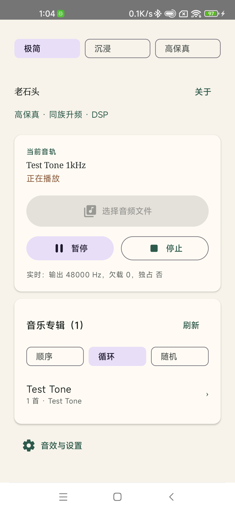
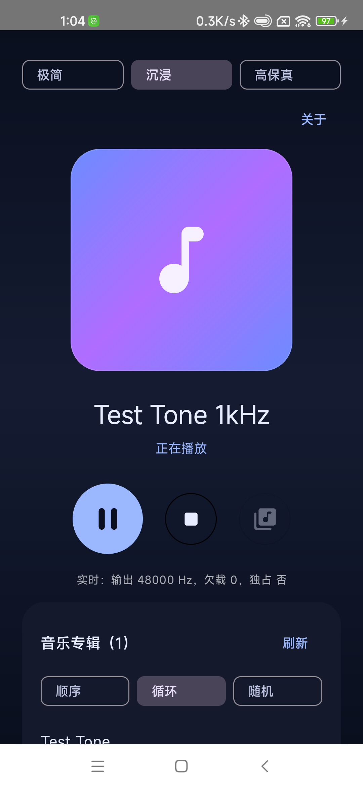
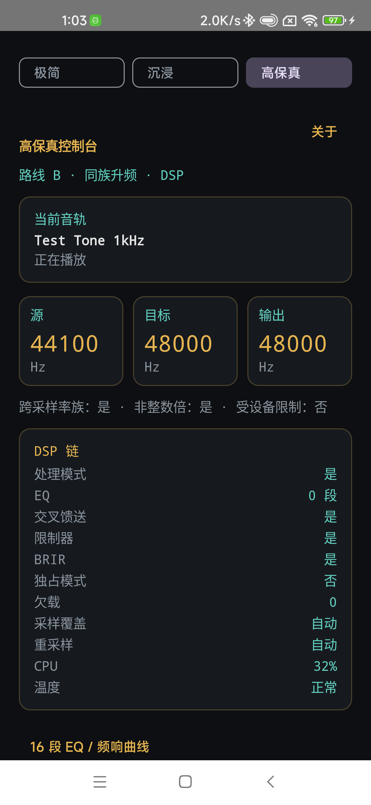

# 老石头 · LaoShiTou

本地优先、音质优先的 Android 播放器。**无广告、无在线曲库、无账号、无遥测，未申请 `INTERNET` 权限**；解码、DSP、文件访问全部在本机完成，系统云备份也已关闭。音乐库读取手机根目录的 `laoshitou/` 文件夹，为此申请「所有文件访问」权限。

> **本软件所有代码开源，免费下载。如果你是花钱买的，你被骗了，请立刻退款并举报。**

**作者：[xjjilly](https://github.com/xjjilly)** · **License: [GNU GPLv3](LICENSE)** · [Third-party notices](THIRD_PARTY_NOTICES.md)

## 界面

| 极简 | 沉浸 | 高保真 |
|:---:|:---:|:---:|
|  |  |  |

## 核心特性

- **硬核 DSP 链**：16 段可视化 PEQ（IIR / 线性相位 FIR）、PK/LSC/HSC/HPF/LPF、2/4 阶级联、AutoEQ txt/CSV/GraphicEQ 导入、预增益与可调限制器、三段多段压缩。
- **预设系统**：12 个场景预设（FPS 听声辩位、电影、流行、摇滚、古典、播客、深夜、低音增强、高音、Live 等）；调好的 16 段 EQ 与开关可存为**用户预设**，重启保留。
- **EQ 实时调音**：播放中应用 16 段 EQ 立即生效（无需重新播放）；选中频点显示精确数值，±0.5dB 微调。
- **Oboe 低延迟输出**：请求 Exclusive 独占模式，设备不支持时自动回退 Shared；USB DAC 自动 192k。
- **DSD 与高解析**：DSD64（DSF/DFF，非压缩）本地解码；FLAC/WAV/ALAC/AAC/MP3/APE/WavPack/TTA 等由 FFmpeg 原生解码。
- **BRIR 卷积混响**：分区 FFT、立体声 BRIR WAV、湿/干比例可调，约 43 ms 分块延迟；内置 9 个 BRIR/HRTF 测试素材（SADIE II 等），首次启动自动复制到应用 IR 目录。
- **声场控制**：libbs2b Crossfeed 强度、M/S 声场拓宽（0-150%）、响度补偿与限幅保护。
- **设备切换自动恢复**：蓝牙/有线/USB 路由变化导致 Oboe 断流时自动重开；同采样率保留环形缓冲与 DSP 状态，采样率变化则重建重采样与 DSP 链。
- **三种界面**：极简 / 沉浸 / 高保真，共享同一播放与曲库状态。
- **纯本地曲库**：扫描手机根目录 `laoshitou/` 文件夹，专辑按子文件夹组织，顺序/循环/随机，支持媒体按键、前台服务与音频焦点。
- **隐私优先**：无 `INTERNET` 权限、无广告 SDK、无在线曲库、无遥测；仅申请「所有文件访问」（读取 `laoshitou/` 音乐目录所需，DSD 等非标准媒体扩展名无法用常规媒体权限读取）；`android:allowBackup="false"`，不向云端备份数据。
- **GPLv3**：完整源代码随发布提供，第三方组件许可见 [THIRD_PARTY_NOTICES.md](THIRD_PARTY_NOTICES.md)。

## Architecture (Route B)

```
FFmpeg decode thread
  -> planar float -> interleaved
  -> libsamplerate (SRC_SINC_BEST_QUALITY)
  -> lock-free SPSC ring (200-500 ms)
  -> Oboe callback: preamp/PEQ (AutoEQ) -> crossfeed -> look-ahead limiter -> volume fade
  -> Oboe output (Exclusive requested, Shared fallback)
```

Two playback modes:

- **Direct**: bit-perfect, DSP bypassed, source sample rate when the device
  supports it.
- **Processing**: family-preserving integer-multiple upsampling, then DSP.

## Status

- [x] Architecture and library selection
- [x] `SampleRatePolicy` implementation and host tests
- [x] SPSC PCM ring buffer (PortAudio) and host tests
- [x] Kotlin + Compose app shell, JNI, Oboe Prefab
- [x] Oboe output backend + 440 Hz test tone (Exclusive requested, actual
      sharing mode / rate reported in the UI)
- [x] FFmpeg 7.1 LGPL static build (arm64-v8a) linked into the native library;
      the UI reports the FFmpeg version
- [x] FFmpeg decode pump + file playback path (decode -> stereo float ->
      libsamplerate -> SPSC ring -> Oboe)
- [x] Fully Chinese UI: buttons, labels, status, errors
- [x] Three selectable UI versions: 极简 / 沉浸 / 高保真
- [x] Family-based Processing mode wired into file playback (Kotlin device
      rates -> C++ `SampleRatePolicy` -> Oboe target -> libsamplerate)
- [x] DSP chain: AutoEQ/RBJ PEQ (PK/LSC/HSC + preamp), libbs2b crossfeed,
      look-ahead limiter; Processing/Direct modes
- [x] AutoEQ profile import: ParametricEQ/FixedBandEQ txt, parametric CSV,
      measurement/response CSV and GraphicEQ (fitted to PK/LSC/HSC biquads)
- [x] EQ band order: single 2nd-order biquad or cascaded 4th-order; shelves
      use Q or the RBJ slope S (UI toggles + file fields)
- [x] DSDIFF `.dff` playback for uncompressed DSD64 (custom FRM8 parser +
      FFmpeg `dsd_msbf` decoder); DST-compressed files are rejected
- [x] Playlist modes: sequential, list loop and shuffle with auto-advance
- [x] Host tests: 15/15 (sample rate, ring, resampler, AutoEQ parser/fit, PEQ,
      crossfeed, limiter, loudness, DSP chain, DFF reader, FFT,
      partitioned convolution, IR loading, BRIR wet/dry)
- [x] SAF audio file picker (OpenDocument; selected file is copied to app cache)
- [x] MediaSession + foreground service + MediaStyle notification + audio
      focus/ducking/becoming-noisy + media buttons
- [x] Album library shared by all three UIs: each subfolder is an album named
      after the folder; tap an album, then a track
- [x] Offline PC DSP tool (`tools/hifi_offline`) reusing `core-dsp`, with a
      REW test plan in `docs/OFFLINE_DSP_TEST_PLAN.md`
- [x] Performance controls: USB output-rate override, resampler quality, and
      live CPU/thermal readouts on the 高保真 dashboard
- [x] Soundstage: continuous Crossfeed strength, M/S stereo width (0-150%),
      mono-compatibility metric in the offline tool
- [x] Volume-linked loudness compensation (live, driven by the system media
      volume) and four device presets (录音棚 / 深夜动铁 / 近场书架 / 现场)
- [x] No built-in headphone database: AutoEQ profiles are still loaded from
      a file (picker or manual path), per the product decision
- [x] 16-band visual EQ editor with a log-frequency response curve (drag
      handles, auto preamp, apply as a ParametricEQ profile)
- [x] Proactive warnings: high CPU/downsampling (e.g. 192k -> 48k at 107%)
      and Preamp > +6 dB (suggests full-size/high-impedance headphones)
- [x] Adaptive app icon (dark background, amber/cyan level bars)
- [x] Adjustable limiter threshold (-12..0 dBFS in the UI; engine accepts
      -24..0) with a host test for a -6 dBFS threshold
- [x] In-app channel/polarity test: generates left -> right -> in-phase ->
      out-of-phase 1 kHz segments and plays them in Direct mode
- [x] Settings persistence: output-rate override, resampler quality, the
      16-band editor gains/preamp and the applied visual EQ survive restarts
      (SharedPreferences `player_settings`)
- [x] USB DAC auto 192k: for 48 kHz-family PCM up to 192 kHz, the app requests
      192 kHz when a USB output is present; 44.1-family and manual overrides
      are left alone
- [x] "载入当前 EQ 文件": parses the current AutoEQ profile with the native
      loader and fits it to the 16 visual bands (preamp included)
- [x] 关于 screen (accessible from all three UIs) with an app introduction,
      feature list, third-party notices, privacy note and the reward QR:
      "软件完全免费，拒绝盗版，赞赏仅为支持作者。"
- [x] BRIR convolution: partitioned FFT engine, WAV IR loading, wet/dry mix,
      IR folder + file picker, ~43 ms block latency. License-clean test IRs are
      under `samples/ir/` (UniS HRTF MIT, SADIE II BRIR Apache-2.0, MIT
      environmental IR CC BY 4.0).
- [x] Output recovery after a platform stream disconnect (USB DAC unplug,
      Bluetooth/wired route change): Oboe `onErrorAfterClose` flags the closed
      stream and the playback monitor reopens it. If the new route keeps the
      same rate the ring, resampler and DSP state are preserved; if the actual
      rate changes, the resampler and DSP chain are rebuilt at the new rate.
      Verified on the test phone by toggling Bluetooth (44.1, 96 and 192 kHz
      requests, 0 underruns, paused streams reopen paused).
- [x] Network test IRs with explicit licenses: UniS anechoic HRTF (MIT),
      SADIE II room BRIR (Apache-2.0) and an MIT environmental IR (CC BY 4.0),
      plus a SOFA/mono-pair conversion tool. See `samples/ir/README.md`.
- [x] Release compliance: no `libfdk_aac`, `--enable-gpl`, `--enable-nonfree`
      or `--enable-version3` in FFmpeg; native AAC decoder only; libsamplerate
      is BSD-2-Clause; no test music in the APK or source tree.
- [x] Music library: scans `/sdcard/laoshitou/` at startup and on return to
      foreground, with scan status feedback and an empty-library hint showing
      where to copy music; one-tap migration from the old app-private folder;
      All Files Access permission flow (API 30+)
- [ ] Seek/position/duration
- [ ] Device verification of Exclusive mode and long-run stability

## Audio route changes

Oboe reports `ErrorDisconnected` when the platform closes the output stream
(USB DAC unplug, Bluetooth or wired route change). `PlaybackService` checks the
native engine every 500 ms and reopens the stream:

- same actual rate: ring, resampler and DSP state are kept, so playback resumes
  at the same position;
- different actual rate: the resampler and DSP chain are rebuilt at the new
  rate; the decoder position is kept but buffered ring data is discarded;
- paused playback stays paused across the reconnect.

Reproduce on the test phone:

```sh
adb logcat -s AudioEngine OboeOutput PlaybackService
adb shell svc bluetooth disable   # stream closes, route moves to speaker
adb shell svc bluetooth enable    # route moves back to A2DP
```

Expected log after each route change:

```
OboeOutput: stream closed: -899
AudioEngine: output disconnected; reopening (requested=48000 actual=48000)
OboeOutput: opened: sharing=1 format=2 rate=48000 channels=2
AudioEngine: output reopened: requested=48000 actual=48000 (ring preserved)
```

## Download / install

- Signed release APK: `artifacts/app-release-signed.apk`
- Debug build: `app/build/outputs/apk/debug/app-debug.apk`
- Checksums: `artifacts/SHA256SUMS`
- Release notes: `RELEASE_NOTES_v1.1.md`

```sh
adb install -r artifacts/app-release-signed.apk
```

The signed release uses a local PKCS12 keystore that is **not** committed.
To build it yourself:

1. Create a keystore, e.g.

   ```sh
   keytool -genkeypair -v -keystore laoshitou-release.jks \
     -storetype PKCS12 -alias laoshitou -keyalg RSA -keysize 4096 \
     -validity 10000 -dname "CN=LaoShiTou, O=LaoShiTou, C=CN"
   ```

2. Copy `keystore.properties.example` to `keystore.properties` and fill in
   `storeFile`, `storePassword`, `keyAlias` and `keyPassword`. The file is
   gitignored; never commit it.

3. Build:

   ```sh
   ./gradlew :app:assembleRelease
   # app/build/outputs/apk/release/app-release.apk
   ```

The GPLv3 corresponding source bundle is
`artifacts/laoshitou-1.1-source.tar.gz`; it includes the app source,
third-party sources, license texts and the exact FFmpeg 7.1 tarball. Publish
it together with any binary release.

On the phone, open **老石头**:

1. Tap **测试音** to validate the Oboe path. The UI reports the actual
   output rate and whether Oboe granted Exclusive mode.
2. The **音乐专辑** card scans `/sdcard/laoshitou/` at startup and after
   **扫描**, and rescans automatically whenever the app returns to the
   foreground. Each subfolder is one album, named after the folder. Tap an
   album, then a track; the playing track is highlighted and all three UI
   versions share the same album/queue state. On first run, grant **所有文件
   访问** when prompted (tap **授权访问** in the library card); music from the
   old app-private folder can be moved over with **迁移旧目录音乐**. When the
   library is empty, the three UIs show a hint to copy music into the
   `laoshitou/` folder on the phone root. Copy albums with:

```sh
adb push "D:/music/MyAlbum" /sdcard/laoshitou/MyAlbum/
```

3. Tap **选择音频文件** and pick an audio file from the system file picker, or
   tap **选择音频文件夹** to import a whole folder: its audio files are copied
   into `laoshitou/<folder>/` (subfolder structure kept, unique names on
   collision) and it appears as an album after the import. Or push an audio
   file to the manual path and tap **按路径播放**:

```sh
adb push test.wav /sdcard/Android/data/com.gu.laoshitou/files/test.wav
adb push samples/eq_test.txt /sdcard/Android/data/com.gu.laoshitou/files/eq.txt
adb logcat -s OboeOutput AudioEngine
```

Supported containers/decoders in the current FFmpeg build: FLAC, WAV/W64,
AIFF, CAF, ALAC, AAC, MP3, Opus, Vorbis, APE, WavPack, TTA, DSF (DSD), and
uncompressed DSDIFF/DFF (DSD64). FFmpeg 7.1 has no DSDIFF demuxer, so the app
parses the `FRM8` container itself and feeds the DSD bytes to FFmpeg's
`dsd_msbf` decoder. DST-compressed DFF is not supported.

Processing mode uses the family-based sample-rate policy and the DSP chain;
Direct mode bypasses the chain. The EQ profile is an AutoEQ
`ParametricEQ.txt`; a test profile is in `samples/eq_test.txt`.

## DSP chain (Processing mode)

- **PEQ**: exact AutoEQ/RBJ formulas for `PK` (peaking), `LSC` (low shelf),
  `HSC` (high shelf), `HPF` (high pass) and `LPF` (low pass), plus the AutoEQ
  `Preamp`; up to 16 bands. Each band is one 2nd-order biquad or two cascaded
  biquads (4th order); cascaded stages use half the band gain each, so total
  gain is unchanged. Shelves can use `Q` or the RBJ shelf slope `S`
  (0 < S <= 1). The profile is loaded from the path shown in the UI.
- **Loudness**: a live, volume-linked stage using fixed one-pole low/high
  filters mixed into the dry signal. As the system media volume drops, the
  low (≈60 Hz) and high (≈10 kHz) mix amounts increase; no coefficients are
  recomputed in the audio callback, so it is click-free. The 高保真 screen
  toggles it; it can also be enabled by the 深夜动铁 preset.
- **Stereo width**: a Mid/Side matrix with a 0-150% control (0 = mono,
  100% = original). The mono sum (L+R) is unaffected by this matrix.
- **Crossfeed**: continuous strength (0-100%) interpolating the bs2b feed
  (1.0-9.5 dB) and cutoff (700-650 Hz), in addition to the weak/medium/strong
  presets. Combined with M/S width for the "soundstage" controls.
- **BRIR**: a stereo WAV impulse response is convolved with the left/right
  inputs using a uniform partitioned FFT (block 2048, frequency-domain delay
  line). Wet/dry mix is adjustable; the dry path is delayed by the same
  2048 frames (~43 ms at 48 kHz) so the mix does not comb-filter. IRs are
  resampled to the processing rate and truncated to 2 s. The chain order is
  PEQ -> loudness -> M/S width -> crossfeed -> BRIR -> limiter. Measured test
  IRs and their licenses are listed in `samples/ir/README.md`.
- **Crossfeed**: MIT libbs2b (weak/medium/strong; default weak).
- **Limiter**: stereo look-ahead peak limiter, adjustable threshold
  (default -1 dBFS; UI -12..0), 5 ms look-ahead, 100 ms release.
- **Direct mode** passes `nullptr` to the DSP chain and is bit-perfect
  (no EQ/crossfeed/limiter).

The AutoEQ importer supports:

- **ParametricEQ.txt / FixedBandEQ.txt**: `Preamp: ... dB` and
  `Filter N: ON PK/LSC/HSC Fc ... Gain ... Q ...`.
- **Parametric CSV**: `Type,Frequency,Gain,Q,Enabled` rows with `PK`/`LSC`/
  `HSC` (also accept `Peak`, `LS`, `HS` aliases), plus optional `Slope` and
  `Order` (1 or 2) columns. A headerless `PK,1000,6,1` form is accepted too.
  Parametric text accepts `Slope S` and `Order 2` tokens as well.
- **Response CSV**: AutoEQ measurement exports
  (`frequency,raw,smoothed,error,equalization`) use the `equalization` column
  directly, `error` is negated, and a plain `frequency,gain` file is treated
  as the correction curve. The curve is fitted to 12 biquad bands
  (LSC 105 Hz, ten PK bands, HSC 10 kHz) with a damped Gauss-Newton gain
  solve; the preamp is set to the negative fitted peak and near-zero bands
  are dropped.
- **GraphicEQ**: `GraphicEQ: 20 -3.0; 21 -3.1; ...` is fitted the same way.

The PEQ itself is the standard AutoEQ/RBJ biquad design; **LSC/HSC are RBJ
shelves** whose Q controls the slope, or `Slope S` selects the RBJ
shelf-slope formulation. The advanced settings expose **EQ 4 阶级联** and a
**搁架使用斜率 S** switch/slider; both apply at the next playback start.
EQ/crossfeed/limiter are configured before playback starts; changing them
requires stopping and restarting playback. Sample profiles:
`samples/eq_test.txt`, `samples/eq_demo.csv`,
`samples/eq_demo_parametric.csv`.

The resampler quality is selectable (自动 / BEST / MEDIUM / FASTEST). **自动**
uses `SRC_SINC_BEST_QUALITY` for PCM sources up to 192 kHz (including
192k -> 48k) and `SRC_SINC_MEDIUM_QUALITY` for DSD/higher rates (352.8 kHz
and above), where BEST cannot sustain real time on mobile. The app also
exposes a **manual output-rate override** (自动 / 44.1k / 48k / 96k / 192k)
for USB DACs whose `AudioDeviceInfo` only reports 48 kHz. With the lifeme
dongle, 192k exclusive output was stable at 0 underruns; 384k is not offered
because the Android USB route rejected it.

## Performance tuning (phone + USB DAC)

The advanced settings contain:

- **输出采样率**: 自动 / 44.1k / 48k / 96k / 192k. For USB DACs whose
  `AudioDeviceInfo` only reports 48 kHz this bypasses the policy and requests
  the chosen rate; Oboe reports the actual rate, and the engine falls back to
  the source/native rate if the request is rejected.
- **重采样质量**: 自动 / BEST / MEDIUM / FASTEST. 自动 = BEST for PCM up to
  192 kHz, MEDIUM for DSD/352.8 kHz and above.
- The 高保真 DSP card shows **CPU%**, **温度** (PowerManager thermal status),
  采样覆盖 and the selected resampler quality.

Measured on the Mi 10 Pro with the lifeme Hi-Fi Audio Pro dongle (Android 12):

| Case | Output | Underruns | CPU (process) |
|---|---|---|---|
| DSD64 352.8k, auto (MEDIUM) | 48 kHz | 0 | ~83% (producer ~72%) |
| PCM 192k, auto (BEST) | 48 kHz | 0 | ~95% |
| PCM 192k, override 192k (native) | 192 kHz | 0 | ~56% |
| DSD64, override 192k (MEDIUM) | 192 kHz | 0 | ~118% |
| DSD64, override 192k + BEST | 192 kHz | thousands | not viable |
| Override 384k | — | — | Android USB route rejects it |

Thermal status stayed at 0 (normal) in all runs; about 700% of 800% CPU time
remained idle. DSD decoding with `thread_count = 2` measured *higher* CPU
than single-thread on this phone, so it was reverted. The output-rate
override is session-only; 192k files play bit-for-bit at 192k when selected.

## Music library

- The library scans `/sdcard/laoshitou/` (the `laoshitou/` folder on the phone
  root) recursively (up to 8 levels) for the supported containers, ordered
  naturally by relative path (01, 02, ..., 10, ...). Reading it requires the
  **All Files Access** permission (API 30+; `READ_EXTERNAL_STORAGE` on API
  26-29) because DSD/APE extensions are not covered by the regular media
  permissions. The folder is created on first scan once access is granted.
- Each folder that directly contains audio files is one album, named after
  the folder ("未分类" for files in the scan root). Tracks inside an album
  are sorted naturally; albums are ordered by relative path.
- Music from the old app-private location
  (`Android/data/com.gu.laoshitou/files/Music/`) is offered a one-tap
  migration (**迁移旧目录音乐**) when the new folder is empty.
- Example album layouts on the device:
  - `音乐/BEYOND` → `laoshitou/BEYOND/`: 16 DSD64 `.dff` tracks, played directly.
  - `音乐/绝对发烧1 SACD` → `laoshitou/绝对发烧1 SACD/`: 12 WAV tracks,
    24-bit/192 kHz stereo.
- The list and the current-track highlight are shared state, so switching
  UI versions does not interrupt playback or lose the selection.
- Playlist modes are shared by all three UIs:
  - **顺序**: advance to the next track and stop after the last one.
  - **循环**: advance and wrap from the last track to the first; when a file
    outside the library is playing, it is replayed.
  - **随机**: pick a random next track, never repeating the current one.
  Auto-advance starts only after the ring has drained, so track tails are
  not cut off.
- **扫描** rescans the folder; files added over adb show up without a
  restart. The library also rescans automatically when the app returns to
  the foreground, and the status line reports the scan result.

## Offline DSP verification

`tools/hifi_offline.cpp` is a PC-side executable that links the same
`core-dsp` static library as the app:

```
WAV -> [resampler] -> PEQ/preamp -> crossfeed -> limiter -> float32 WAV
```

It supports `--eq`, `--order 1|2`, `--slope S`, `--crossfeed`,
`--crossfeed-width`, `--width` (M/S), `--loudness-volume`, `--limiter`,
`--limiter-threshold`, `--brir`, `--brir-mix`, `--rate`, `--quality` and
`--dry`, and prints a mono-compatibility metric. Build it with the host CMake tree; the binary is
`build-host/tools/hifi_offline.exe`. This makes it possible to verify the
DSP frequency response, crossfeed crosstalk, limiter ceiling and resampler
with REW without a phone in the loop. Full test cases and REW steps are in
[docs/OFFLINE_DSP_TEST_PLAN.md](docs/OFFLINE_DSP_TEST_PLAN.md).

For PC listening tests through a USB DAC/dongle, `tools/pc_wasapi/run.ps1`
probes WASAPI endpoints (shared mix format and exclusive-mode formats) and
plays WAV files in exclusive mode on the selected device. See
[tools/pc_wasapi/README.md](tools/pc_wasapi/README.md).

## File picker and playback service

- Audio file selection uses the Storage Access Framework (`OpenDocument`).
  The selected file is copied to the app cache and played from there; the
  manual path field remains for adb/manual testing.
- Playback runs in a foreground service with a `MediaSession` and a
  `MediaStyle` notification (play/pause/stop). Audio focus, transient ducking,
  `ACTION_AUDIO_BECOMING_NOISY`, and a partial wakelock are handled.
- Media buttons (headset/Bluetooth) control the same session.
- Pause stops consuming the ring after a short fade; resume continues from the
  same ring position.

## UI versions

The app ships with three switchable Compose layouts. The chips at the top of
each screen switch versions without interrupting playback; playback state and
settings are shared.

- **极简**: light paper-like layout, serif headings, card-based controls,
  quick "音效与设置" panel with the AutoEQ file picker, loudness switch,
  Crossfeed strength and M/S width sliders, the four device presets, and the
  channel/polarity test.
- **沉浸**: dark gradient, large album-art placeholder, circular transport
  controls, the same quick panel in an expandable section.
- **高保真**: dark technical dashboard with source/target/output rate cards,
  DSP-chain status, underruns, CPU/thermal, the full advanced panel
  (EQ order/slope, output-rate/resampler controls, **USB DAC 自动 192k**,
  paths, limiter switch and threshold, BRIR switch/IR list/mix),
  and an expandable
  **16 段 EQ / 频响曲线** editor. Drag the 16 handles to
  shape the curve; the dashed line includes Preamp. "自动 Preamp" sets the
  headroom from the curve, and "应用" writes `visual_16band.txt` for the next
  playback. "载入当前 EQ 文件" fits the current AutoEQ profile to the 16 bands.
  The editor gains, Preamp, output-rate override and resampler quality are
  persisted. High CPU/downsampling and Preamp > +6 dB warnings are shown in
  the player and the editor respectively.

There is intentionally **no built-in headphone database**. AutoEQ profiles
are loaded from a `.txt`/`.csv` file via the system picker or the manual path;
the four device presets are small built-in tuning files written to the app's
`EQ/` folder only when selected.

All three layouts include the shared music list and the 顺序/循环/随机 mode
chips below the transport controls.
Current screenshots are in `screenshots/`:

- `ui_minimal.png`, `ui_immersive.png`, `ui_hifi.png` — the three UI modes.
- `ui_about_top.png` — About page (license and privacy).
- `ui_hifi_brir.png` — BRIR active in the 高保真 DSP card.

The default is 极简; the selection is kept for the current session. Older
development screenshots are kept locally under `artifacts/screenshots/legacy/`
and are not part of the source tree.

## UI language

All user-visible UI text is Chinese. Technical proper nouns (FFmpeg, Oboe,
adb, Hz), file paths, and command examples are kept as-is.

## Build host tests

Requires CMake 3.22+ and a C++20 compiler.

```sh
cmake -S . -B build-host -G Ninja \
  -DCMAKE_C_COMPILER=clang \
  -DCMAKE_CXX_COMPILER=clang++ \
  -DCMAKE_EXE_LINKER_FLAGS=-static
cmake --build build-host
ctest --test-dir build-host --output-on-failure
```

FFmpeg static libraries are intentionally not committed to git. Build them
once (the exact FFmpeg 7.1 tarball is bundled at
`third_party/ffmpeg/ffmpeg-7.1.tar.xz`):

```sh
bash tools/build_ffmpeg_arm64.sh
```

Android build:

```sh
export ANDROID_HOME=/path/to/android-sdk
./gradlew :app:assembleDebug
```

## Sample-rate policy

See [docs/SAMPLE_RATE_POLICY.md](docs/SAMPLE_RATE_POLICY.md).

In short:

- 44.1 kHz family: `{44100, 88200, 176400}`
- 48 kHz family: `{48000, 96000, 192000}`
- Processing mode picks the highest supported same-family rate with an integer
  ratio to the source. 44.1/88.2 go to 176.4 when available; 48/96 go to 192.
- 44.1 must never be converted to 96 by default. If the device supports no
  rate in the source family, the policy falls back to the closest reported
  rate (native only when no list is available) and flags
  `cross_family_fallback` for a UI warning.

## Third-party libraries (used, licenses verified)

| Library | License | Purpose |
|---|---|---|
| Oboe 1.11.0 | Apache-2.0 | Low-latency output |
| libsamplerate | BSD-2-Clause | Sample-rate conversion |
| AutoEQ formulas | MIT | Exact PK/LSC/HSC coefficient formulas and profile format |
| DSPFilters | MIT | Vendored RBJ reference (not linked) |
| libbs2b 3.1.0 | MIT | Crossfeed |
| rigtorp/SPSCQueue | MIT | Lock-free command queue |
| PortAudio `pa_ringbuffer` | MIT | SPSC PCM ring buffer |
| FFmpeg 7.1 | LGPL-2.1-or-later (static, arm64-v8a; no GPL/nonfree/libfdk_aac) | Decoding, including DSD/APE/WavPack |
| libebur128 | MIT | ReplayGain / EBU R128 (planned) |
| xiph/rnnoise (optional) | BSD-3-Clause | Speech denoise mode, default off (planned) |

Notices and pinned versions are under `third_party/VERSIONS.md`; the release
notice is `THIRD_PARTY_NOTICES.md`.

## Release compliance

- FFmpeg 7.1 is built with `--disable-gpl --disable-nonfree
  --disable-version3`; `CONFIG_LIBFDK_AAC`, `CONFIG_GPL`, `CONFIG_NONFREE` and
  `CONFIG_VERSION3` are all `0` in `config.h`. AAC decoding uses FFmpeg's
  native decoder; all encoders are disabled (`--disable-encoders`).
- `libsamplerate` is the 0.2.x BSD-2-Clause version, not the old GPL release.
- The APK contains no audio files. Test music is never packaged; the only
  audio in the tree is the three license-cleared IR WAVs under `samples/ir/`.
- The unlicensed KEMAR files, raw multi-hundred-MB datasets and generated test
  tones were removed before release.
- The app is GPLv3. Because FFmpeg is linked statically, a binary release must
  be accompanied by the complete corresponding source, including the exact
  FFmpeg 7.1 source and `tools/build_ffmpeg_arm64.sh`. The tarball is included
  at `third_party/ffmpeg/ffmpeg-7.1.tar.xz`; see `THIRD_PARTY_NOTICES.md` for
  the URL and SHA-256.

## License

Copyright (c) 2026 老石头 contributors.

This program is free software: you can redistribute it and/or modify it under
the terms of the GNU General Public License as published by the Free Software
Foundation, version 3 of the License.

This program is distributed in the hope that it will be useful, but WITHOUT
ANY WARRANTY; without even the implied warranty of MERCHANTABILITY or FITNESS
FOR A PARTICULAR PURPOSE. See the GNU General Public License for more details.

The full license text is in `LICENSE`. Third-party components retain their own
licenses; see `THIRD_PARTY_NOTICES.md` and `third_party/`.

## 赞赏支持

开发纯属个人爱好，无广告无内购。如果这个引擎和软件让你的耳机焕发了新生，或者对你有帮助，欢迎请作者喝杯咖啡。

<p align="center">
  
</p>

<p align="center">GitHub: <a href="https://github.com/xjjilly">@xjjilly</a></p>
