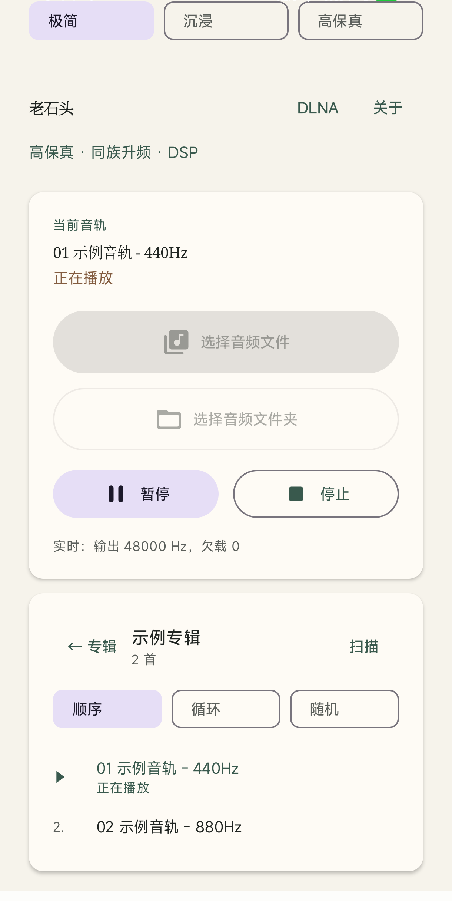
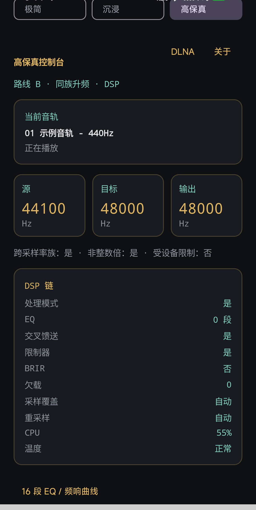
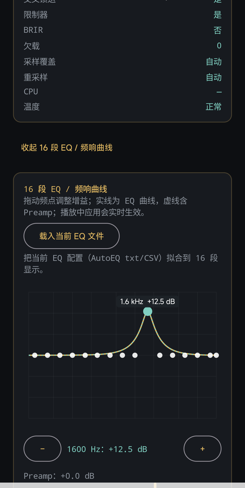
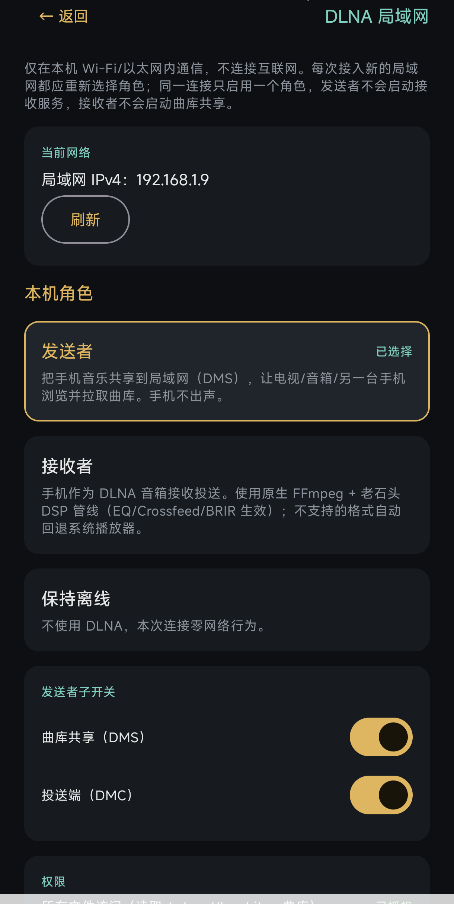
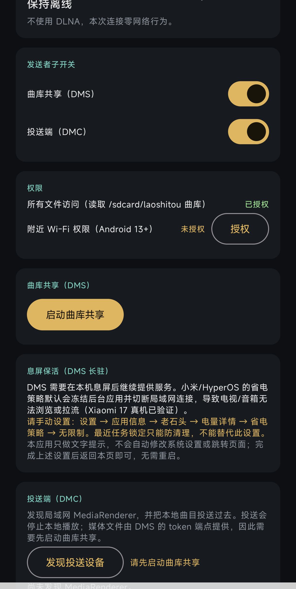

# 老石头 APK 使用说明书（小白版）

适用版本：**1.5**（versionCode 7）

老石头是一个“把音乐放在手机里、安安静静播放”的本地音乐播放器：
无广告、无在线曲库、无账号、无遥测。默认不联网；DLNA 局域网播放是可选功能，
只有你主动开启后才会在同一个 Wi-Fi/局域网内工作。

1.5 版新增：NAS / SQL 曲库与真实封面、WebDAV 凭据配置、作为发送者投送 PC、
作为接收者当 DLNA 音箱、锁屏播放保活；本地播放与 DSP 部分继续适用。

> 本软件开源免费。如果你是花钱买的，你被骗了，请立刻退款并举报。

> 本文截图使用合成的“示例音轨 - 440Hz / 880Hz”，不含任何版权音乐或封面。

---

## 目录

1. [安装前确认](#1-安装前确认)
2. [安装 APK](#2-安装-apk)
3. [第一次打开：权限与音乐目录](#3-第一次打开权限与音乐目录)
4. [播放音乐](#4-播放音乐)
5. [音效与界面](#5-音效与界面)
6. [DLNA 局域网播放](#6-dlna-局域网播放)
7. [小米/HyperOS 必看：省电策略](#7-小米hyperos-必看省电策略)
8. [常见问题](#8-常见问题)
9. [隐私与网络说明](#9-隐私与网络说明)
10. [版本、校验与反馈](#10-版本校验与反馈)
11. [使用场景与玩法推荐](#11-使用场景与玩法推荐)

---

## 1. 安装前确认

- 手机系统：Android 8.0（API 26）或更高。
- 处理器：arm64-v8a（近几年的主流安卓手机基本都满足）。
- 需要允许“安装未知来源应用”（不同品牌位置不同，通常在
  “设置 → 应用 → 特殊权限 → 安装未知应用”里）。
- 本说明书对应版本：**1.5**。

## 2. 安装 APK

### 方法一：手机上直接安装（推荐小白）

1. 把 `LaoShiTou-Android-v1.5-signed.apk` 传到手机（微信文件传输、数据线、
   网盘均可）。
2. 用手机的文件管理器找到这个 APK，点一下。
3. 如果系统提示“禁止安装未知应用”，点“设置”，允许当前文件管理器安装应用。
4. 点“安装”，等待完成，桌面会出现“老石头”图标。

### 方法二：用电脑 adb 安装（进阶）

```sh
adb install -r LaoShiTou-Android-v1.5-signed.apk
```

### 安装失败怎么办？

- 提示“应用未安装 / 签名不一致”：手机里可能装过**别的签名**的旧版本。
  先卸载旧版再安装。卸载不会删除 `/sdcard/laoshitou/` 里的音乐文件。
- 提示“解析软件包出错”：APK 没传完整，重新传一次。
- 提示“版本降级”：新 APK 的版本号比已安装的低，请确认使用的是 1.5 版。

## 3. 第一次打开：权限与音乐目录

打开“老石头”后，按界面提示操作：

1. **所有文件访问（必须）**
   - 用途：读取手机根目录 `laoshitou/` 文件夹里的音乐。
   - 路径：设置 → 应用 → 特殊权限 → 所有文件访问 → 老石头 → 允许。
   - 如果只给“音频权限”，DSD/APE 等非标准扩展名可能读不到，所以需要这个权限。
2. **通知权限（建议允许）**
   - 用途：DLNA 接收/共享时显示前台服务通知，系统才不容易中断它。
3. **附近 Wi-Fi 权限（Android 13+，使用 DLNA 时允许）**
   - 用途：局域网组播发现 DLNA 设备；不用于定位。
4. **DLNA 默认是关闭的**
   - 不使用 DLNA 时，应用不发起任何网络请求。需要时再到 DLNA 页面开启。

### 把音乐放进去

在手机内部存储根目录新建文件夹 `laoshitou`，每个子文件夹就是一张专辑：

```text
/sdcard/laoshitou/
├── 周杰伦 - 范特西/
│   ├── 01 爱在西元前.flac
│   └── 02 简单爱.flac
└── 测试专辑/
    └── test.wav
```

- 用数据线从电脑复制也可以：

  ```sh
  adb push "D:/music/周杰伦 - 范特西" /sdcard/laoshitou/
  ```

- 支持格式：FLAC、WAV/W64、AIFF、CAF、ALAC、AAC、MP3、Opus、Vorbis、APE、
  WavPack、TTA、DSF（DSD）、未压缩 DSDIFF/DFF（DSD64）。
  DST 压缩的 DFF 不支持。
- 放好后回到应用，点“扫描”或重新进入应用，专辑列表会刷新。

| 格式 | 本地播放 | DLNA DMR 投送 |
|---|---|---|
| FLAC / WAV / MP3 / AAC 等 | 支持 | 支持 |
| DSF（DSD64） | 支持 | 支持 |
| DFF（未压缩 DSD64） | 支持 | **不支持**（请先转成 DSF） |
| DST 压缩 DFF | 不支持 | 不支持 |



### DSD（DSF）为什么比较耗 CPU？

DSD64 的原始数据率约 **2.8 MHz/声道**。为了播放和音效处理，老石头需要把它
转成 PCM、重采样到输出采样率（测试机为 48 kHz），再经过 DSP 链。在小米 17 上
实测约 **80% 单核占用**，这是正常的：**用硬件算力换音质和 DSP 功能**。

- 手机发热/耗电会相应增加，长时间 DSD 播放建议注意散热。
- 想降低占用：在“高保真控制台”里降低“重采样质量”，或使用直通/Direct 模式
  （会绕过 DSP）。
- 这是 DSD 格式本身的代价，不是故障。

## 4. 播放音乐

1. 在主界面点一张**专辑**。
2. 点专辑里的**曲目**开始播放。
3. 底部/播放页可以：播放/暂停、上一首、下一首、拖动进度、调整音量。
4. 三种界面（极简 / 沉浸 / 高保真）可以随时切换，播放不会中断。
5. 应用退出后，播放可以在通知栏继续控制（取决于系统设置）。

## 5. 音效与界面



高保真界面提供 EQ、Crossfeed、声场、响度、压缩等设置；这些是“锦上添花”，
不影响基本播放。看不懂时保持默认即可。



- **直通（Bypass）**：关闭 DSP，声音最“原始”。
- **处理模式**：开启 DSP 链，按采样率策略处理后再输出。
- DLNA“接收者”模式默认使用**原生 FFmpeg + 老石头 DSP 管线**（EQ/Crossfeed/BRIR/
  限制器生效）；遇到原生不支持的格式会自动回退系统 MediaPlayer。

## 6. DLNA 局域网播放



### 它是干什么的？

DLNA 可以让你把手机里的音乐**共享到同一个 Wi-Fi 里的电视/音箱/另一台手机**，
或者让手机**变成一台 DLNA 音箱**，接收别的设备投过来的音乐。

- 必须：两台设备连接**同一个 Wi-Fi / 局域网**。
- 不需要：互联网、账号、云端。
- 每次接入新的局域网，应用都会让你重新选角色：
  - **发送者**：共享曲库（DMS）+ 投送（DMC）。
  - **接收者**：手机作为 DLNA 音箱（DMR）。
  - **保持离线**：本次不使用 DLNA。

### 作为发送者（共享曲库 / 投送）

1. 角色选“发送者”。
2. 打开“曲库共享（DMS）”，点“启动曲库共享”。
   - 之后同一局域网的电视/音箱/手机可以浏览并播放你的曲库。
3. 如果要**主动投送**到另一台设备：
   - 打开“投送端（DMC）”，点“发现投送设备”。
   - 选择目标设备，选择专辑/曲目，开始投送。
   - 投送会停止本机本地播放；媒体文件由 DMS 提供，所以要先启动曲库共享。
4. 播放中可以暂停/继续、拖动进度、调音量、停止。
5. 如果渲染器断电/掉线，界面会显示“渲染器已离线，正在重试…”，
   恢复后会自动清除；恢复后不会自动重投，需要你重新选曲。

### 作为接收者（手机变音箱）

1. 角色选“接收者”。
2. 点“启动接收”。
3. 同一局域网的控制点（比如另一台手机的老石头 DMC、电脑上的 DLNA 控制软件）
   会看到名为“老石头 DMR”的设备。
4. 接收期间本机会停止本地播放；声音走原生 FFmpeg + DSP 管线（使用启动接收时
   播放器当前的处理/直通模式与 EQ/Crossfeed/BRIR/响度/限制器设置）；
   不支持的格式会自动回退系统 MediaPlayer。
5. DMR 支持 FLAC/WAV/MP3/AAC/DSF 等 FFmpeg 格式；**DFF（DSDIFF）暂不支持**
   （DFF 可在本地播放器播放，但不能通过 DLNA 投送给 DMR）。
6. 若启用了 16 段可视化 EQ，DMR 会使用同一组 EQ；运行中回到播放器页重新
   应用 EQ（按钮显示“应用（实时生效）”）会实时更新 DMR。
5. 系统播控键/通知栏可以控制播放/暂停；停止接收后恢复普通播放器状态。

## 7. 小米/HyperOS 必看：省电策略



**这是小米/HyperOS 用户使用 DLNA（曲库共享 DMS、接收 DMR，或同机第三方渲染器）时最重要的一步。**

### 为什么会断？

小米/HyperOS 的省电策略默认会在息屏后**冻结后台应用并切断局域网连接**。
即使应用有前台服务通知、也拿了 Wi-Fi 锁，系统仍可能把它冻住，表现是：
电视/音箱突然浏览不到曲库、投送中断、页面一直转圈。

### 怎么设置（请手动操作）

1. 打开手机的“设置”。
2. 进入“应用信息 / 应用管理”，找到“老石头”。
3. 点“电量详情”（有的版本叫“耗电情况”）。
4. 点“省电策略”。
5. 选择 **“无限制”**。
6. 返回应用即可，不需要重启手机。

> **最近任务里的“锁定”不够用**：它只能防止一键清理，不能阻止系统在息屏后
> 冻结应用、切断网络。真正有效的是上面的“省电策略 → 无限制”。

### 应用会自己改设置吗？

**不会。** 老石头只在 DMS 界面用文字提示你手动设置，不会自动修改系统设置，
也不会自动跳转页面。设置一次后长期有效（除非你手动改回或系统重置）。

### 投送到本机的 Kodi 等第三方渲染器

如果投送目标是**同一台小米手机上的第三方渲染器应用**（例如 Kodi 的 UPnP
渲染器），同样需要把**该渲染器应用**的省电策略设为“无限制”。否则息屏或
后台一段时间后，系统会冻结它的后台 UPnP 服务，表现为投送突然中断或提示
渲染器离线。

路径：设置 → 应用信息 → 该渲染器应用（如 Kodi）→ 电量详情 → 省电策略 →
无限制。

老石头检测到投送目标就是本机时，会在 DMC 面板显示这条提示；应用本身不会
修改其他应用的系统设置。

## 8. 常见问题

### Q1：打开应用找不到音乐？

- 确认音乐在 `/sdcard/laoshitou/` 下，每个子文件夹是一张专辑。
- 确认已授予“所有文件访问”。
- 回到应用点“扫描”，或退出重进。

### Q2：播放没有声音？

- 检查手机媒体音量是否静音。
- 检查是否连接了蓝牙/耳机/USB DAC，声音可能从别的设备输出。
- 高保真界面的 DSP 设置太“重”时，先试试切到直通。

### Q3：DLNA 搜不到设备？

- 两台设备必须在**同一个 Wi-Fi/局域网**。
- 路由器如果开了“AP 隔离/访客网络”，设备之间会互相看不到，请关闭。
- Android 13+ 请授予“附近 Wi-Fi”权限。
- 点“刷新”或重新进入 DLNA 页面再试。
- 小米/HyperOS 请先完成第 7 节的省电策略设置。

### Q4：投送失败/一直转圈？

- 先确认对方的渲染器在线（没断电、没退出 DLNA 应用）。
- 确认已启动“曲库共享（DMS）”，DMC 的媒体地址依赖 DMS。
- 如果提示格式不支持，可以点“仍要尝试”碰碰运气，或换一首兼容格式。
- 如果渲染器就在本机（如 Kodi），请把该渲染器应用的省电策略也设为
  “无限制”（见第 7 节）。
- 渲染器重启后不会自动重投，请重新选曲投送。

### Q5：息屏后曲库共享就断了？

先按第 7 节把“省电策略”设为“无限制”。这是小米/HyperOS 的已知行为，
不是应用崩溃。

### Q6：更新版本会丢数据吗？

用相同签名的 APK 直接覆盖安装（`adb install -r` 或手机点安装）会保留应用数据；
音乐文件在 `/sdcard/laoshitou/`，卸载应用也不会删除。只有卸载会清掉应用内的
设置和预设。

### Q7：为什么 DFF 不能通过 DLNA 投送？

DMR 的原生解码使用 FFmpeg；FFmpeg 7.1 **不带 DSDIFF (DFF) demuxer**，所以
DMR 不能播放 DFF。**DSF 可以正常投送**。DFF 在本地播放器里可以播放（应用自带
DFF 解析）；如需通过 DLNA 投送，请先把 DFF 转成 DSF。这是格式边界，不是音质
问题。

### Q8：为什么播放 DSF/DSD 时 CPU 很高？

见第 4 节“DSD 为什么比较耗 CPU”：DSD64 需要转 PCM、重采样并跑 DSP，
测试机上约 80% 单核是正常的“算力换音质”代价；可降低重采样质量或用直通模式。

### Q9：怎么卸载？

长按桌面“老石头”图标 → 应用信息 → 卸载。或用：

```sh
adb uninstall com.gu.laoshitou
```

## 9. 隐私与网络说明

- **默认离线**：不开启 DLNA 时，应用不发起任何网络请求。
- **DLNA 可选且仅局域网**：只加入局域网组播、监听局域网端口、访问局域网内的
  控制/媒体地址；不连接互联网、不上传文件。
- 为 DLNA 申请了 `INTERNET`、`ACCESS_NETWORK_STATE`、`ACCESS_WIFI_STATE`、
  `CHANGE_WIFI_MULTICAST_STATE`、`NEARBY_WIFI_DEVICES`；关闭 DLNA 时这些权限
  不会被用来联网。
- 存储权限只用于读取 `laoshitou/` 音乐目录。
- 无广告 SDK、无账号、无遥测、无云备份（`android:allowBackup="false"`）。

## 10. 版本、校验与反馈

- 版本：**1.5**（versionCode 7）
- 包名：`com.gu.laoshitou`
- 签名证书 SHA-256：
  `eb14ff089e17f6790bbe01cf67669152d86a5921e94d1a108dcb8d51945c7fe8`
- APK SHA-256：
  `b99d780de6ce4980972d7b0a5bff8d8f112ebbc3c99af1d9100f051a7627664f`
- 校验 APK（可选，进阶）：
  - Windows：`certutil -hashfile LaoShiTou-Android-v1.5-signed.apk SHA256`
  - macOS/Linux：`sha256sum LaoShiTou-Android-v1.5-signed.apk`
  - 官方校验和文件：`artifacts/SHA256SUMS-v1.5.txt`
- 项目主页与问题反馈：<https://github.com/xjjilly/laoshitou>
- 软件许可证：GNU GPLv3（见 `LICENSE`）

---

## 11. 使用场景与玩法推荐

- **手机本地听歌**：把音乐放进 `/sdcard/laoshitou/`，扫描后按专辑播放；
  锁屏后由前台服务与唤醒锁保持播放。
- **NAS / SQL 曲库**：在「曲库 → NAS → 配置」填写 SQL API 地址与 Token；
  封面、专辑、曲目直接从 NAS 索引加载。
- **手机选歌、PC 出声**：选择「发送者」，开启 DMC、启动曲库共享（DMS），
  发现并选择「老石头 PC」，在 NAS 曲库里点「投送」。
- **手机当第二只音箱**：切「接收者」，启动 DMR；PC 或其他设备投送手机，
  手机用原生 FFmpeg + 老石头 DSP 播放。
- **锁屏 / 口袋模式**：投送后锁屏，PC 继续播放；本地播放锁屏也不断。
- **NAS + 手机 + PC 三端**：NAS 存、PC 听、手机控/听；同一连接只启用一个
  DLNA 角色，避免 DMC/DMR 冲突。
- **弱网/缓存**：PC 端对 NAS 的 WAV/FLAC 会边下边播；手机端 NAS 曲目投送
  同样走局域网，网络抖动时以 PC 端缓存为准。

**更多玩法，等待用户发掘**：不同角色组合、投送目标切换、锁屏/通知控制、
NAS 封面墙、DSP 预设与本地/远程曲库混用……都值得慢慢试。
欢迎反馈你的玩法与问题，下一版说明会继续补充。
